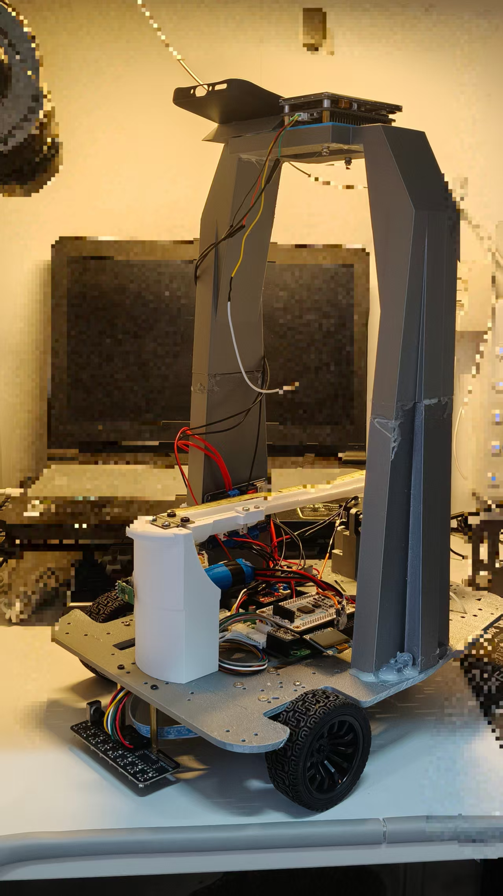
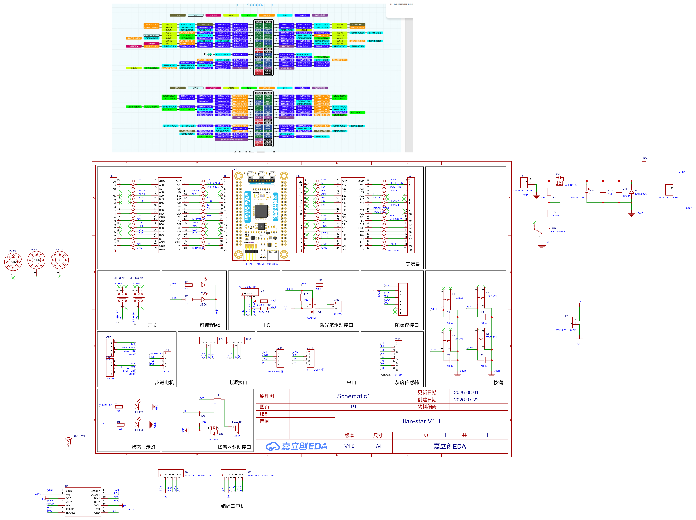

# MSPM0G3507 车载钢球平衡控制系统

基于 TI MSPM0G3507 的裸机控制项目，集成双轮差速底盘、编码器速度闭环、灰度循迹、K230 视觉位置输入、HTS-25L 舵机控球、ICM20602 姿态与加速度处理，以及 OLED 比赛任务菜单。

本仓库提供 MCU 固件，包含五种可执行任务模式。比赛题号、实车完成时间、停车距离和控球精度尚需结合测试记录说明；源码中的完成判定不代表全部赛题要求已通过验收。

## 功能

| 模式 | 主要行为 | 结束条件 |
| --- | --- | --- |
| TRACK LAP | 循迹一圈、弯道计数、末段渐减速 | 发车屏蔽 5s 后连续确认终点黑线停车，不受弯道计数限制 |
| STATIC O+5-5 | 钢球移到 +5cm，再到 -5cm；加速、制动与位置闭环 | 各目标满足位置、球速和连续保持时间 |
| AB CENTER | AB 段行驶，中心控球、速度规划与前馈 | 屏蔽时间后检测明显循迹误差，软停车 |
| LAP CENTER | 整圈循迹，钢球保持中心 | 终点黑线确认后软停车，继续控球 500ms |
| LAP TARGET | 整圈指定位置控球，默认 +5cm | 停车后误差≤1cm、球速≤0.5cm/s，连续 500ms；3s 未稳定则故障 |

以上数值为当前代码配置与判定阈值，不代表实测性能。任务参数位于 `app_task_track_lap.c`、`app_task_static_ball.c` 和 `app_task_mobile_ball.c`。

## 工程结构与调度

| 目录或文件 | 职责 |
| --- | --- |
| `chaiss/BSP/` | GPIO、PWM、编码器、UART、按键与中断适配 |
| `chaiss/DVE/` | 底盘速度环、循迹传感器与舵机协议 |
| `chaiss/GYRO/` | SPI 与 ICM20602 设备处理 |
| `chaiss/app/` | 调度、比赛任务、外环控制、菜单和通信 |
| `chaiss/keil/` | Keil 工程、启动文件与链接配置 |
| `chaiss/main.c`、`main.syscfg` | 初始化、主循环与芯片配置 |

主循环调用 `APP_Scheduler_RunOnce()`。底盘硬件定时器产生 20ms 标志，由 `APP_ChassisControl_Task()` 消费并更新速度内环；IMU 在主循环中按 10ms 周期采样。钢球控制随有效视觉新帧更新，另有视觉超时保护；SysTick 提供 1ms 时间基准，OLED 最后执行。

默认底盘外环为循迹。蓝牙代码保留，但 `app_scheduler.c` 中的 `APP_Command_Task()` 已注释，默认比赛版本不执行蓝牙命令任务。实际调度顺序与功能开关以源码为准。

Kv/Ka 的运行时调参值在任务切换时保留：静态往返仅关闭这两项补偿输出，移动控球重新启用；位置PID的Kd与独立IMU前馈不受此开关影响。

## 硬件与连接

主控采用天猛星 MSPM0G3507 核心板，插接到自制 PCB 扩展板使用，当前 CPU 时钟 80MHz。整车照片和扩展板原理图见下；机械尺寸与整车完整接线图尚待补充。

### 实物照片与扩展板原理图

查看天猛星自制扩展板原理图

原理图展示自制扩展板及板载接口，不包含所有外接模块的完整接线和整车供电布线。

| 部件 | 实际型号或规格 | 用途 |
| --- | --- | --- |
| 主控板 | 天猛星 MSPM0G3507，核心板具体版本待补充 | 主循环、控制环、外设通信 |
| 底盘电机 | 520 电机，12V、333rpm，带编码器 | 双轮差速底盘；实际轮速需编码器反馈确认 |
| 电机驱动 | TB6612，自制 PCB 扩展板 | 左右轮驱动；核心板插接使用 |
| 电池 | 标称 12V 锂电池，容量 1800mAh | 整车电源；容量不代表最大输出电流 |
| 舵机 | HTS-25L 单总线舵机 | 钢球横梁倾角控制，降压至 7.4V 供电 |
| 视觉板 | 庐山派 K230，摄像头型号待补充 | 钢球识别、厘米位置换算和串口发送 |
| 显示 | 0.96 英寸 I2C OLED，控制芯片待补充 | 菜单、运行时间与状态显示 |
| 循迹传感器 | 荣扬电子 8 路灰度传感器 | 数字循迹输入与停车位置检测 |
| IMU | ICM20602 | 姿态解算与动态加速度前馈 |

### 供电与接地

| 支路 | 供电方式 | 待补充信息 |
| --- | --- | --- |
| 电机 | 12V 电池供电，TB6612 驱动 | 电机堵转电流、驱动板电流能力与保护电路 |
| 舵机 | 电池经降压模块输出 7.4V | 降压模块型号、输出电流能力及接线图 |
| 主控、视觉与其他模块 | 具体稳压支路待补充 | 输入电压、稳压模块及各模块工作电压 |

PCB 将信号地和功率地分开走线，最终在连接点共地，这是分区布线，不是电气隔离。复现接线时应保留共同的信号参考地；共地点位置与大电流回流路径需在后续原理图或接线图中标明。

下表来自当前 `ti_msp_dl_config.h` 和 BSP 映射，表示 MCU 引脚；接线时还应核对器件电平、供电和模块接口。

| 接口 | MCU 引脚 | 说明 |
| --- | --- | --- |
| 左轮 PWM / 方向 | PB18 / PA2、PB24 | 逻辑左轮映射到 MotorB |
| 右轮 PWM / 方向 | PA17 / PB19、PB20 | 逻辑右轮映射到 MotorA |
| 编码器 A：A/B 相 | PB26 / PA12 | A 相双边沿计数，B 相判断方向 |
| 编码器 B：A/B 相 | PA13 / PB23 | A 相双边沿计数，B 相判断方向 |
| 循迹 D1～D4 | PA30、PB21、PB17、PA16 | 排列与黑线有效电平按实物确认 |
| 循迹 D5～D8 | PA14、PB25、PA25、PA27 | 安装方向需与误差符号对应 |
| ICM20602 SPI1 | PB8 PICO、PB7 POCI、PB9 SCLK、PB6 CS | PICO 对 SDI，POCI 对 SDO |
| OLED I2C0 | PA28 SDA、PA31 SCL | 核对模块电压及上拉配置 |
| UART0 TX / RX | PA10 / PA11 | 115200；TX 发舵机指令，RX 收 K230 数据 |
| UART2 TX / RX | PA23 / PA24 | 115200；蓝牙调参接口 |
| SELECT / CONFIRM | PA9 / PA8 | 上拉、低有效 |
| SUB / ADD | PB4 / PB5 | 水平零点调整，上拉、低有效 |

UART0 的 TX/RX 分别承担不同用途，不应将 K230 与舵机发送线直接并联。舵机当前只发指令、不读反馈，使用广播 ID `0xFE`，按单只 HTS-25L 使用，电源由独立降压支路提供 7.4V；单总线信号接法、信号电平和保护元件还需在硬件图中补全。

编码器换算当前采用轮径 68mm、减速后每轮转 330 线、二倍频 660 counts/rev。更换电机或轮胎时应修改 `BSP/bsp_encoder.c` 参数，并核对左右反馈映射和方向。

## 构建与操作

| 项目 | 当前配置 |
| --- | --- |
| IDE | Keil MDK / uVision，具体安装版本待补充 |
| 编译器 | ArmClang 6.21，来自工程配置 |
| TI SDK | MSPM0 SDK 2.10.00.04 |
| 配置工具 | TI SysConfig，具体版本待补充 |
| 构建入口 | `chaiss/keil/main.uvprojx`，目标 `chassis` |

1. 安装工具与 SDK，打开 Keil 工程。
2. 在 Include Paths 和 Before Build 中，把 `D:\TI\CCS\mspm0_sdk_2_10_00_04` 改成你的 SDK 安装路径，确认 SysConfig 生成步骤成功。
3. 执行 Rebuild，检查结果，通过与板卡匹配的调试器下载。
4. 先测试通信、编码器符号和空载电机方向，再安装负载、校准水平零点并调参。

SELECT 切换模式，CONFIRM 进入 3 秒倒计时；倒计时可取消，运行中 CONFIRM 请求停止。`SERVO ZERO` 页面用 SUB/ADD 调整水平零点，CONFIRM 保存到 RAM，SELECT 取消，复位不保留校准值。舵机安全范围以当前源码及实际机械限位为准。

## K230 视觉协议

UART0 RX 接收固定 8 字节帧：

| 字节 | 内容 | 说明 |
| --- | --- | --- |
| 0 | `0xA5` | 帧头 |
| 1 | `0x20` | 钢球 X 位置命令 |
| 2～5 | `float32` 小端 | 单位 cm，中心为 0，正方向与装配方向一致 |
| 6 | 校验和 | 字节 1～5 的和，取低 8 位 |
| 7 | `0x5A` | 帧尾 |

当前输入范围为 ±14cm，MCU 在完整收帧时记录本地时间戳。有效新帧驱动控球，超时触发保护；视觉应连续稳定发送，速度估计与控制效果需要按实际帧率验证。本仓库尚不包含 K230 视觉程序。

蓝牙命令编号见[命令头文件](chaiss/app/app_command.h)，历史说明见[中文串口命令表](chaiss/chassis_uart_commands.txt)，有差异时以源码为准。

## 验证状态与已知问题

历史构建日志记录过 `0 error / 0 warning`，不替代在新环境中重新构建。各模式成功率、运行时间、停车偏差、控球误差、供电与负载条件尚待补充公开测试记录。

任务切换的[主机回归测试](tests/README.md)直接编译控球及任务源码，模拟舵机、底盘和IMU接口，验证静态任务不清空Kv/Ka、静态期间调参保留，以及三个移动模式重新启用补偿。该测试不替代实车控制效果验证。

当前源码检查发现以下待处理项；文档整理没有修改控制代码：

- 静态任务进入 FAULT 后，比赛分发层尚未将该状态通知菜单。
- SDK 绝对路径、蓝牙调用的注释开关和部分历史注释仍需整理。

## 文档与许可

[工程复盘与架构](chaiss/PROJECT_RETROSPECTIVE_AND_ARCHITECTURE.md)记录现有结构与改进方向；[AGENTS.md](chaiss/AGENTS.md)记录开发约定。

本仓库原创代码与项目资料采用 [MIT License](LICENSE)。TI SDK、CMSIS 及其他第三方文件仍按各自许可使用，原有版权声明不受本许可证替代；完整 TI SDK 未打包进本仓库。
